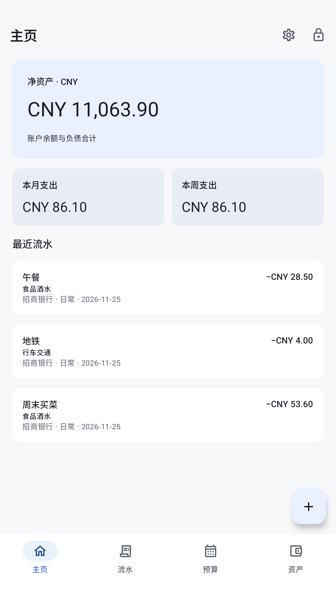
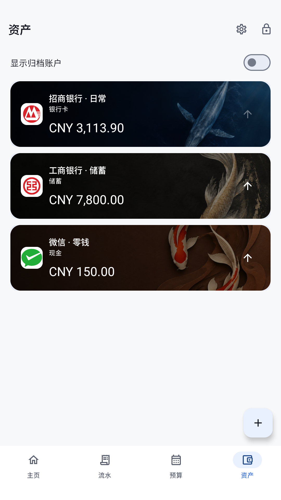
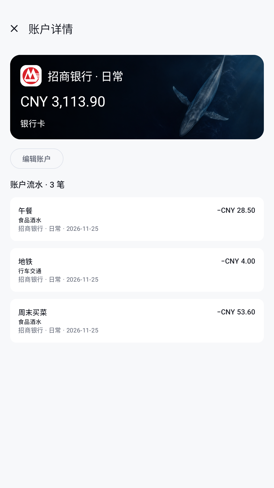

# 有余 · Youyu for Android

有余是一款中文本地记账应用。把现金、银行卡、信用卡和支付钱包放在同一本账里，按实际发生金额记录收支和转账，查看本月预算和每个账户的余额。无需注册，账本保存在手机上。

[下载 Android APK](https://github.com/Casper1226/Youyu-Android/releases/latest/download/Youyu-Android.apk) · [版本记录与 SHA-256 校验值](https://github.com/Casper1226/Youyu-Android/releases) · [反馈问题](https://github.com/Casper1226/Youyu-Android/issues)

## 界面预览

| 主页 | 资产 | 账户详情 |
| --- | --- | --- |
|  |  |  |

截图来自 Android 15 模拟器，账户、余额和流水均为演示数据。

## 第一次使用

1. 在 Android 9 或更高版本的手机上安装 APK，设置至少 12 个字符的金库口令。
2. 打开「资产」添加账户，填入币种和期初余额。账户名称会自动匹配银行或钱包图标。
3. 在主页点「记一笔」，选择支出、收入或转账。在「预算」设置月度上限，回到主页就能查看本周和本月支出。

**请保留口令和原设备。** 此版本的金库绑定设备密钥，目前尚无换机迁移或可恢复的账本导出。卸载、清除应用数据或丢失设备密钥，都会影响已有账本的访问。公开版可以与早期内部测试版并行安装，两者各自保存账本。

## 日常记账

- **账户**支持七种币种、期初余额、校准、排序和归档。支持 27 种机构标识、13 款卡面，也可以从系统相册选图并裁剪。在资产页向右滑动一张卡片，可打开该账户的流水。
- **流水**支持收支、转账、搜索和筛选。跨币种转账分别保存转出、到账金额。主页按选定币种汇总，其他币种分别展示。
- **预算**按月统计。分摊支出可以摊入多个月份，账户余额仍按实际支付时间扣除全额。
- **分类**按收入和支出分组。一级分类可直接展开，子分类默认继承上级样式。删除整组分类前会显示影响范围，历史账单保留在「未分类」。

## 数据与隐私

账本和自定义图片存储在 SQLCipher 加密数据库中。口令通过 Argon2id 派生密钥，并与 Android Keystore 一起保护金库。应用退到后台即锁定，系统备份关闭。发布版无需网络权限，选图使用 Android 系统图片选择器。

## 开发与测试

需要 JDK 21、Android SDK 36。Android Studio 可直接打开仓库根目录。

```sh
./gradlew :domain:test :app:assembleDebug
./gradlew :app:connectedDebugAndroidTest
```

`domain/` 包含金额、分类、账期和预算规则。`app/` 包含 Jetpack Compose 界面、Android Keystore 和 SQLCipher 持久化。测试使用独立的合成账本。调试包使用独立的应用 ID，可与公开版并存。

[自动测试](https://github.com/Casper1226/Youyu-Android/actions/workflows/android.yml) · [构建和签名发布版本](docs/releasing.md) · [第三方依赖说明](docs/third-party.md) · [机构图标来源](docs/institutions.md)

## English

Youyu is a Chinese-language, offline expense tracker for Android 9+. It supports multiple accounts and currencies, transfers, monthly budgets, and custom categories. All ledger data stays on the device. Version 0.1 stores the vault key on the original device. Portable backup and restore are not yet available.
